# SmartCharge — Plan Smarter. Charge Safer.

**SmartCharge** is a production-grade native iOS application developed for **40005 Advanced iOS Applications (Assessment 4: Capstone Project)**. 

Engineered with Swift 6, SwiftUI, Clean Architecture, Core Data, Apple MapKit, and Swift Charts, SmartCharge solves the acute cognitive friction of EV range anxiety on Australian highways by replacing optimistic straight-line calculations with deterministic safety buffers, real driving distances, and corridor-aware multi-stop charging plans.

---

## Key Features

1. **Active EV Profile Management**: Configure theoretical range, battery capacity (kWh), and connector types (CCS2, Type 2 Mennekes, CHAdeMO) with automated default profile persistence.
2. **Dynamic Dual-Tier Battery Mathematics**: Signature dual-tier battery gauge computing physical estimated range alongside a conservative safety planning range with user-configurable emergency buffer reserves (10% to 25%).
3. **MapKit Multi-Stop Route Planner**: Full highway route calculation using `MKDirections`, extracting precise polyline coordinates and scheduling required charging stops with tapered charge time estimations.
4. **Verified Charging Station Finder**: Dual-mode (List and Map) station discovery filtering Australian charging hubs by socket compatibility, minimum power output (kW), and live status.
5. **Smart Charging Stop Recommendations**: Transparent, deterministic ranking prioritizing the safest or fastest charging hubs along your travel corridor.
6. **Swift Charts Route Analytics**: Native visual comparison of safe range, physical range, and route distance, paired with automated infrastructure gap detection.
7. **Apple Human Interface Guidelines (HIG)**: Full Light and Dark Mode adaptivity, high-contrast Electric Ocean palette (WCAG 2.1 AA compliant), Dynamic Type scaling, VoiceOver accessibility elements, and subtle native haptics.

---

## Architectural Overview

SmartCharge adheres to strict **Clean Architecture + MVVM** principles, decoupling presentation frameworks from pure domain business rules and persistence mechanisms.

```mermaid
graph TD
    subgraph Presentation Layer
        V[SwiftUI Views: Dashboard, Planner, Stations, Recommend, Analytics]
        VM[JourneyViewModel - @MainActor & ObservableObject]
        AC[AppContainer - Dependency Injection Root]
    end

    subgraph Domain Layer
        UC1[CalculateVehicleRangeUseCase]
        UC2[FindCompatibleStationsUseCase]
        UC3[RecommendChargingStopUseCase]
        UC4[AnalyseRouteRiskUseCase]
        UC5[MultiStopRoutePlanner]
        UC6[SaveJourneyUseCase]
        DM[Domain Models: Vehicle, Journey, BatteryEstimate, ChargingStation]
        ERR[Typed Domain Errors: RangeCalculationError, JourneyPlanError]
    end

    subgraph Data & Platform Layer
        RP1[VehicleRepositoryProtocol]
        RP2[JourneyRepositoryProtocol]
        RP3[PreferencesRepositoryProtocol]
        RP4[FavouriteStationRepositoryProtocol]
        RP5[StationRepositoryProtocol]
        
        CD1[CoreDataVehicleRepository]
        CD2[CoreDataJourneyRepository]
        CD3[CoreDataPreferencesRepository]
        CD4[CoreDataFavouriteStationRepository]
        CD5[MockStationRepository]
        
        PC[PersistenceController - NSPersistentContainer]
        MK[MapKit Routing - MKDirections & MKLocalSearchCompleter]
    end

    V --> VM
    VM --> UC1
    VM --> UC3
    VM --> UC4
    VM --> UC5
    VM --> MK
    VM --> RP5

    AC --> VM
    AC --> CD1
    AC --> CD2
    AC --> CD3
    AC --> CD4

    UC6 --> RP2
    CD1 -.-> RP1
    CD2 -.-> RP2
    CD3 -.-> RP3
    CD4 -.-> RP4
    CD5 -.-> RP5

    CD1 --> PC
    CD2 --> PC
    CD3 --> PC
    CD4 --> PC
```



---

## Technology Stack

- **Platform:** iOS 17.0+ (Xcode 16+)
- **Languages:** Swift 6 Concurrency Safe
- **UI Framework:** SwiftUI
- **Local Database:** Core Data (Encrypted SQLite store with in-memory test configuration)
- **Mapping & Directions:** Apple MapKit (`MKDirections`, `MKLocalSearchCompleter`, `MKLocalSearch`, SwiftUI `Map`)
- **Visual Analytics:** Apple Swift Charts (`Chart`, `BarMark`)
- **Reactive State:** Combine & `@Published` observable properties
- **Automated Testing:** Swift Testing (`@Suite`, `@Test`) and XCTest UI automation

---

## Project Structure

```text
SmartCharge/
├── App/
│   └── AppContainer.swift             # Dependency injection container & preview factory
├── Presentation/
│   ├── Navigation/MainTabView.swift   # Glassmorphic 5-tab navigation
│   ├── Dashboard/Views/               # Battery gauge & EV profile overview
│   ├── JourneyPlanner/Views/          # MapKit highway routing & leg planning
│   ├── StationFinder/Views/           # Australian charging station explorer
│   ├── Recommendations/Views/         # Strategy ranking & stop selection
│   ├── RouteAnalytics/Views/          # Swift Charts range & risk breakdown
│   ├── Components/                    # BatteryGaugeView, MetricCardView, RiskBadgeView
│   ├── Theme/AppTheme.swift           # Electric Ocean adaptive color palette
│   └── ViewModels/JourneyViewModel.swift # Central reactive journey state coordinator
├── Domain/
│   ├── Models/                        # Vehicle, Journey, BatteryEstimate, Station
│   ├── UseCases/                      # Range math, route planning, risk evaluation
│   └── Errors/DomainErrors.swift      # Typed LocalizedError definitions
├── Data/
│   ├── Repositories/                  # CoreData repositories & protocol interfaces
│   └── MockData/MockDataGenerator.swift # Seed data for offline testing & benchmarks
├── Platform/
│   ├── Routing/RouteCalculationService.swift # Real MapKit driving distance calculation
│   └── Location/LocationSearchService.swift # Live address autocomplete & geocoding
├── SmartCharge.xcdatamodeld           # Relational schema (4 entities)
└── SmartChargeApp.swift               # Application entry point
```

---

## Getting Started

### Prerequisites
- macOS Sonoma 14.5+ or macOS Sequoia 15.0+
- Xcode 16.0 or later
- iOS 17.0+ Simulator or physical device

### Installation & Execution
1. Clone the repository locally:
   ```bash
   git clone https://github.com/vickyneves/SmartCharge.git
   cd SmartCharge
   ```
2. Open `SmartCharge.xcodeproj` in Xcode:
   ```bash
   open SmartCharge.xcodeproj
   ```
3. Select the `SmartCharge` scheme and target an **iPhone 17 Pro** (or iPhone 16) Simulator.
4. Press **⌘R** (Run) to build and launch the application.

---

## Automated Test Suite

SmartCharge features comprehensive automated test coverage with **0 failures and 0 warnings**:

```bash
# Execute unit tests
xcodebuild test -scheme SmartCharge -destination 'platform=iOS Simulator,name=iPhone 17 Pro' -only-testing:SmartChargeTests

# Execute UI automation tests
xcodebuild test -scheme SmartCharge -destination 'platform=iOS Simulator,name=iPhone 17 Pro' -only-testing:SmartChargeUITests
```

### Verified Test Breakdown (38 Unit Tests + 6 UI Executions)
- **RangeCalculationTests (7 tests):** Blueprint 400 km / 15% safety benchmark, theoretical range bounds, configurable reserve thresholds (10% to 25%), and zero battery defenses.
- **ReachabilityInvariantTests (5 tests):** Mandatory mathematical invariant that stations exceeding physical battery range are *never* labeled reachable; safety reserve margin boundaries.
- **ConnectorCompatibilityTests (4 tests):** CCS2, Type 2, and CHAdeMO vehicle-socket matching; minimum power threshold filtering; non-operational station exclusion.
- **MultiStopRoutePlannerTests (4 tests):** Direct trip planning (0 stops), long-distance multi-stop routing (Sydney to Melbourne, 880 km), infrastructure gap detection, and charging speed preferences.
- **RouteRiskTests (4 tests):** Deterministic 0-100 risk scoring evaluating critical deficits, buffer incursions, and isolated corridor segments.
- **ReactiveJourneyViewModelTests (6 tests):** Dynamic state updates, vehicle swapping, route reversal, and defensive clearing upon routing failure.
- **CoreDataRepositoryTests (8 tests):** CRUD persistence for Vehicles, Saved Journeys, User Preferences, and Favourite Stations using in-memory testing stores.
- **SmartChargeUITests (6 executions):** Tab switching, cross-tab synchronization, multi-orientation launch tests, and automated promotional screenshot capture.

---

## Assessment Deliverables & Evidence

- **Academic Capstone Report:** [`Docs/SmartCharge_Assessment_Report.md`](file:///Users/ivnr/Documents/Documents:iOSApps/SmartCharge/Docs/SmartCharge_Assessment_Report.md)
- **App Store Submission Metadata:** [`Docs/AppStoreMetadata.md`](file:///Users/ivnr/Documents/Documents:iOSApps/SmartCharge/Docs/AppStoreMetadata.md)
- **Privacy Policy:** [`Docs/PrivacyPolicy.md`](file:///Users/ivnr/Documents/Documents:iOSApps/SmartCharge/Docs/PrivacyPolicy.md)
- **App Privacy Nutrition Disclosures:** [`Docs/AppPrivacyDisclosureDraft.md`](file:///Users/ivnr/Documents/Documents:iOSApps/SmartCharge/Docs/AppPrivacyDisclosureDraft.md)
- **Promotional Screenshots:** Located in [`Docs/Screenshots/`](file:///Users/ivnr/Documents/Documents:iOSApps/SmartCharge/Docs/Screenshots/)

---

## License & Attribution

Author: **Vicky Neves Rohr**  
UTS Subject: **40005 Advanced iOS Applications — Assessment 4**  
© 2026 Vicky Neves Rohr. All rights reserved.
