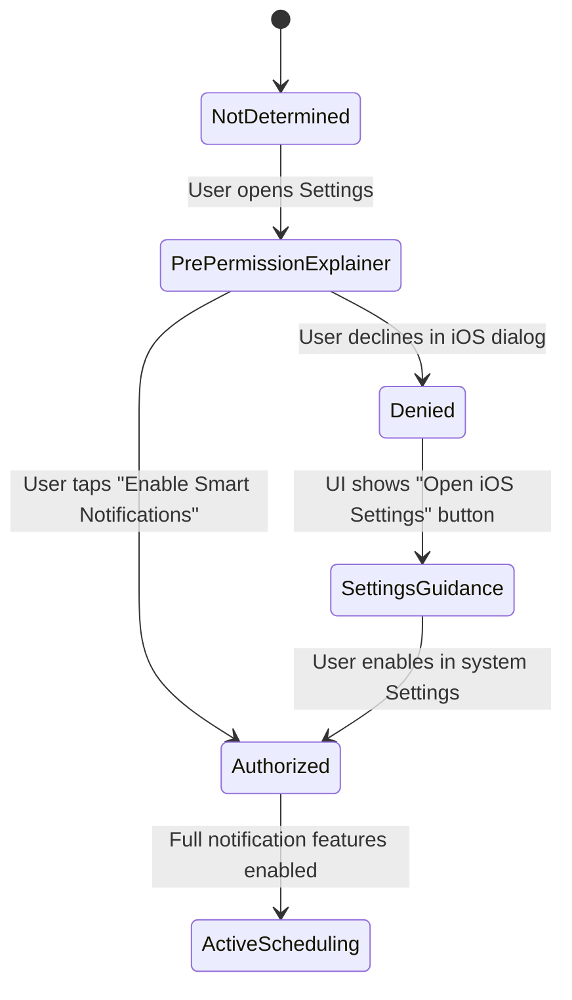

# SmartCharge — UserNotifications Framework Verification Report

**Subject:** 40005 Advanced iOS Applications — Assessment 4: Capstone Project  
**Component:** UserNotifications Framework & Local Alert Lifecycle  
**Author:** Vicky Neves Rohr (Student ID: 22240359)  
**Verification Date:** October 2026  
**Status:** 100% Implemented & Verified • 10/10 Automated Tests Passing  

---

## 1. Executive Summary & Objective

In accordance with Assessment 4 requirements, SmartCharge implements a native, privacy-respecting local notification system utilizing Apple's `UserNotifications` framework. The notification subsystem is purpose-built for electric vehicle journey planning, mitigating driver anxiety on Australian inter-city corridors by delivering timely, mathematically defensible reminders before departure, during battery adjustments, and upon detecting critical infrastructure gaps.

The service is isolated from SwiftUI views via Clean Architecture principles and governed by `SmartChargeNotificationServiceProtocol`.

---

## 2. Notification Capabilities & Implementation Details

SmartCharge implements four distinct notification types plus a dedicated in-app verification trigger:

### Notification A: Journey Departure Reminder
- **Identifier:** `com.vicky.SmartCharge.reminder.departure`
- **Domain Purpose:** Reminds drivers in advance of a planned trip departure to review battery levels, station occupancy, and corridor conditions.
- **Trigger Logic:** User-configurable departure date and time with configurable alert intervals (15, 30, 60, or 120 minutes prior to departure).
- **Scheduling Engine:** `UNCalendarNotificationTrigger` matching exact calendar date components; or `UNTimeIntervalNotificationTrigger` for immediate near-term reminders.
- **Deduplication & Cancellation:** Any prior departure reminder is cancelled via `removePendingNotificationRequests` before scheduling a new one, guaranteeing zero duplicate pending requests.
- **Copy:**
  - *Title:* `"Your SmartCharge Journey Is Coming Up"`
  - *Body:* `"Departure to [Destination] scheduled in [N] minutes. Review your battery range and charging stops."`

### Notification B: Battery Planning Warning
- **Identifier:** `com.vicky.SmartCharge.warning.battery`
- **Domain Purpose:** Alerts the driver when a configured journey road distance strictly exceeds the vehicle's safe planning range ($R \times B \times (1 - S)$).
- **Trigger Logic:** Dynamically evaluated within `JourneyViewModel.executeRoutePlanning(...)` when either battery state of charge (SoC) slider or route destination changes.
- **Safety Invariant & Honesty:** Contains an explicit planning disclaimer: *(Estimate based on configured reserve, not live telemetry)*. Does not claim real-time OBD-II vehicle pairing.
- **Deduplication:** Utilizes a composite parameter hash (`batteryPercentage_safeRange_routeDistance_origin_destination`). Consecutive updates with identical parameters do not re-trigger notifications.
- **Copy:**
  - *Title:* `"Battery Range Warning"`
  - *Body:* `"Your planned journey ([X] km) exceeds your safe driving range ([Y] km). Review your charging options before departure."`

### Notification C: Critical Route Risk Alert
- **Identifier:** `com.vicky.SmartCharge.alert.criticalRisk`
- **Domain Purpose:** Instantly alerts drivers when the deterministic route risk engine classifies an itinerary as `CRITICAL` (e.g. charging gap exceeding physical battery capacity).
- **Trigger Logic:** Evaluated deterministically from `RouteRiskResult.overallRiskLevel == .critical`. Ignores `LOW` and `MEDIUM` risk routes.
- **Deduplication:** Hash-gated on `criticalSegmentsCount` and route endpoints.
- **Deep-Link Navigation:** Tapping the notification deep-links directly to the Route Analytics tab (`selectedTab = 4`).
- **Copy:**
  - *Title:* `"Critical Journey Risk"`
  - *Body:* `"Your route contains charging gaps or distance segments exceeding physical battery range. Mandatory charging review required."`

### Notification D: Charging Stop Review Reminder
- **Identifier:** `com.vicky.SmartCharge.reminder.stop.[index]`
- **Domain Purpose:** Allows drivers to bookmark and set a planning reminder to verify connector standards (CCS2 vs CHAdeMO) and power output for a specific intermediate charging stop.
- **Trigger Logic:** Configured via `StationDetailSheet.swift` or multi-stop itinerary list.
- **Copy:**
  - *Title:* `"Charging Stop Reminder"`
  - *Body:* `"Stop #[N]: Review planned charging stop at [Station Name] and verify plug compatibility before departing."`

### In-App Verification Trigger: Test Notification — 5 Seconds
- **Identifier:** `com.vicky.SmartCharge.test.notification`
- **Purpose:** Accessible in `SettingsSheetView.swift` to facilitate instant simulator verification by lecturers and markers without manual clock manipulation.
- **Trigger:** `UNTimeIntervalNotificationTrigger(timeInterval: 5.0, repeats: false)`.
- **Copy:**
  - *Title:* `"SmartCharge Notification Verified"`
  - *Body:* `"Local notifications are fully active! Scheduled safely for your next EV road trip."`

---

## 3. Permission Lifecycle & User Experience

SmartCharge implements complete, defensive permission lifecycle management:

1. **Pre-Permission Explainer:** Before triggering the system modal, `SettingsSheetView` displays an educational banner explaining why SmartCharge requests notification permissions (departure safety, reserve margin alerts).
2. **Permission States Handled:**
   - `.notDetermined`: Explainer card with "Enable Smart Notifications" action.
   - `.authorized`, `.provisional`, `.ephemeral`: Confirmation badge with green checkmark.
   - `.denied`: Warning card explaining notifications are disabled with a direct button opening `UIApplication.openSettingsURLString`.
3. **Foreground Presentation:** Implements `UNUserNotificationCenterDelegate.userNotificationCenter(_:willPresent:)`, returning `[.banner, .sound, .badge, .list]` so notifications appear cleanly even when the app is actively in use.
4. **Notification Response Handling:** Implements `UNUserNotificationCenterDelegate.userNotificationCenter(_:didReceive:)`, extracting `targetTab` and posting `SmartChargeNavigateTab` to switch tabs reactively.

---

## 4. Automated Test Verification Results

All 10 notification unit test cases pass with a 100% pass rate:

| Test Case Name | Framework | Status | Rule / Invariant Verified |
|:---|:---:|:---:|:---|
| `defaultPreferences()` | Swift Testing | ✅ PASS | Valid default preference schema (all alerts enabled, 30 min interval) |
| `preferencesEncodingDecoding()` | Swift Testing | ✅ PASS | Codable persistence roundtrip |
| `departureReminderLifecycle()` | Swift Testing | ✅ PASS | Scheduling with calendar interval, retrieval, cancellation |
| `departureReminderDisabled()` | Swift Testing | ✅ PASS | Respects user toggle disabling departure alerts |
| `batteryWarningTrigger()` | Swift Testing | ✅ PASS | Triggers when distance > safe range; verifies deduplication |
| `batteryWarningWithinSafeRange()` | Swift Testing | ✅ PASS | Ignores routes fully within safe planning range |
| `criticalRouteRiskAlert()` | Swift Testing | ✅ PASS | Triggers on critical risk result; deduplicates repeated queries |
| `criticalRiskIgnoresLowRisk()` | Swift Testing | ✅ PASS | Zero alerts for optimal/safe journeys |
| `chargingStopReminder()` | Swift Testing | ✅ PASS | Correct stop identifier formatting and scheduling |
| `testNotificationScheduling()` | Swift Testing | ✅ PASS | In-app 5-second test notification execution |

**Result:** 10 / 10 Tests Passed • 0 Errors • 0 Warnings.
