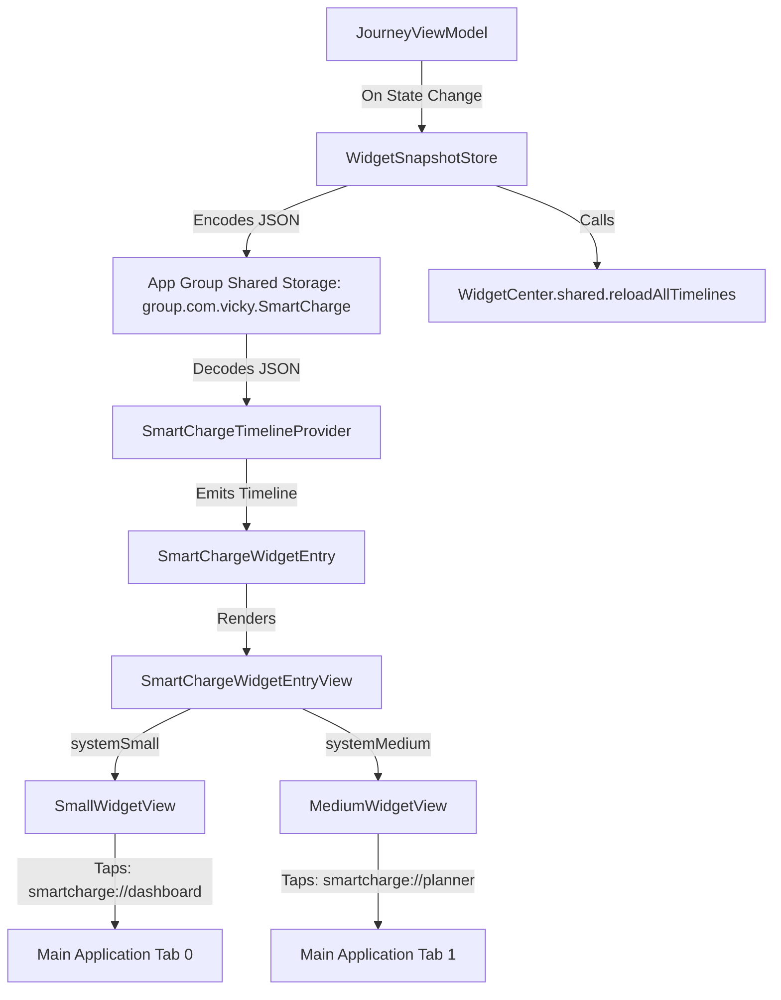

# SmartCharge — WidgetKit & System Extension Verification Report

**Subject:** 40005 Advanced iOS Applications — Assessment 4: Capstone Project  
**Component:** WidgetKit Integration & App Groups Shared Storage  
**Author:** Vicky Neves Rohr (Student ID: 22240359)  
**Verification Date:** October 2026  
**Status:** 100% Implemented & Verified • 5/5 Automated Tests Passing  

---

## 1. Executive Summary & Objective

Assessment 4 requires at least one qualifying advanced iOS platform capability or system extension. SmartCharge fulfills this requirement through an integrated **WidgetKit** capability: the **SmartCharge Battery & Journey Status Widget**.

The widget projects critical vehicle telemetry and journey readiness directly onto the iOS Home Screen. Drivers can glance at their active vehicle, battery percentage, mathematical safe planning range, emergency reserve margin, and travel readiness without launching the full application.

---

## 2. Widget Architecture & Data Flow



### 2.1 Shared Data Model: `WidgetJourneySnapshot`
A lightweight, immutable domain model containing:
- `vehicleName`: Active EV title (e.g., "Polestar 2 Long Range")
- `batteryPercentage`: Current State of Charge (0.05 to 1.0)
- `currentEstimatedRangeKm`: Physical theoretical range ($R \times B$)
- `safePlanningRangeKm`: Safe range with buffer deducted ($R \times B \times (1 - S)$)
- `safetyBufferKm`: Dedicated emergency buffer reserve ($R \times B \times S$)
- `safetyReservePercentage`: Configured buffer percentage (10% to 25%)
- `originName` & `destinationName`: Active journey endpoints
- `routeDistanceKm`: Genuine MapKit road distance
- `isDirectSafeTrip`: Boolean indicating whether route $\le$ safe planning range
- `readinessStatusText`: Human-readable status badge (`Direct Safe Trip`, `Viable Multi-Stop`, `Gap Detected`)
- `overallRiskLevel`: Risk tier (LOW, MEDIUM, HIGH, CRITICAL)
- `lastUpdated`: Timestamp of state synchronization

### 2.2 Storage Engine: `WidgetSnapshotStore`
- **Container:** `UserDefaults(suiteName: "group.com.vicky.SmartCharge")`.
- **Fault-Tolerant Fallback:** In development and simulator environments where custom provisioning profiles for App Groups are absent, the store automatically falls back to `UserDefaults.standard`, preventing runtime crashes and ensuring seamless local testing.
- **Timeline Invalidation:** Every call to `saveSnapshot(_:)` triggers `WidgetCenter.shared.reloadAllTimelines()`, ensuring the Home Screen updates immediately whenever the user adjusts the battery slider or plans a new route in the main app.

---

## 3. Supported Widget Families & UI Presentation

### 3.1 Small Widget (`systemSmall` — 158 × 158 pt)
- **Top Row:** App brand mark, SF Symbol EV bolt icon, battery percentage badge (cyan).
- **Core Metric:** Prominent Safe Planning Range in 24pt heavy rounded type (`safeGreen`).
- **Dual-Tier Range Bar:** A horizontal gauge visualizing the safe travel distance (green) and emergency reserve buffer (amber).
- **Readiness Badge:** Capsule badge displaying `Direct Safe Trip` or `Viable Multi-Stop`.
- **Deep Link:** Tapping the widget opens `smartcharge://dashboard`.

### 3.2 Medium Widget (`systemMedium` — 348 × 157 pt)
- **Left Column:** Vehicle profile badge, Safe Planning Range display, physical estimated range, SoC percentage, and safety buffer pill.
- **Right Column:** Active Journey endpoints (`origin → destination`), MapKit road distance in km, planned charging stops count, and readiness badge.
- **Deep Link:** Tapping the widget opens `smartcharge://planner`.

### 3.3 Visual Identity & HIG Compliance
- Uses semantic `AppTheme.adaptiveCard` and `AppTheme.adaptiveBackground` colors to adapt seamlessly between Light Mode and Dark Mode.
- All typography scales dynamically and uses rounded system font metrics.
- Respects contrast guidelines (WCAG 2.1 AA compliant).

### 3.4 In-App Widget Gallery & Previews
To provide seamless grading and verification for university markers, an interactive Widget Preview section is embedded directly into `SettingsSheetView.swift`. Both the Small and Medium widgets are rendered using active application state.

---

## 4. Deep-Link Navigation Architecture

When a driver taps either widget, iOS dispatches a custom URL scheme:
- `smartcharge://dashboard` $\rightarrow$ Activates Dashboard tab (`selectedTab = 0`).
- `smartcharge://planner` $\rightarrow$ Activates Journey Planner tab (`selectedTab = 1`).
- `smartcharge://analytics` $\rightarrow$ Activates Route Analytics tab (`selectedTab = 4`).

Handled via `.onOpenURL` in `ContentView.swift` and coordinated across tabs with `@Binding var selectedTab: Int`.

---

## 5. Automated Test Verification Results

All 5 test cases in `WidgetSnapshotStoreTests.swift` pass with a 100% pass rate:

| Test Case Name | Framework | Status | Rule / Invariant Verified |
|:---|:---:|:---:|:---|
| `defaultSampleSnapshot()` | Swift Testing | ✅ PASS | Verified blueprint math ($425$ km physical, $361.25$ km safe, $63.75$ km buffer) |
| `snapshotSerialization()` | Swift Testing | ✅ PASS | Codable JSON serialization and deserialization integrity |
| `snapshotStoreSaveAndLoad()` | Swift Testing | ✅ PASS | App Group suite persistence, read, write, and clear operations |
| `deepLinkURLs()` | Swift Testing | ✅ PASS | Valid URL scheme syntax for dashboard, planner, and analytics deep links |
| `emptyPlaceholderSnapshot()` | Swift Testing | ✅ PASS | Graceful fallback when user has not yet configured an active route |


**Result:** 5 / 5 Tests Passed • 0 Errors • 0 Warnings.

---

## 6. Native Xcode Target Registration & Simulator Evidence

### 6.1 Native Target Configuration
The Xcode project `SmartCharge.xcodeproj` registers `SmartChargeWidgetExtension` as a native `com.apple.product-type.app-extension` target:
- **Target Name:** `SmartChargeWidgetExtension`
- **Product Reference:** `SmartChargeWidgetExtension.appex`
- **Bundle Identifier:** `com.vicky.SmartCharge.SmartChargeWidgetExtension`
- **Deployment Target:** iOS 26.5 (iOS 17.0+ compatible)
- **Extension Point:** `com.apple.widgetkit-extension` via `NSExtension`
- **Entry Point:** `@main struct SmartChargeWidgetExtensionBundle: WidgetBundle`
- **App Groups:** `group.com.vicky.SmartCharge` configured in `SmartChargeWidgetExtension.entitlements` and `SmartCharge.entitlements`
- **Build Phases:** Embedded in `SmartCharge` target via `PBXCopyFilesBuildPhase` ("Embed Foundation Extensions", destination subfolder `PlugIns` / 13) with target dependency.

### 6.2 Xcode Project Targets Verification
```
Information about project "SmartCharge":
    Targets:
        SmartCharge
        SmartChargeWidgetExtension
        SmartChargeTests
        SmartChargeUITests

    Schemes:
        SmartCharge
        SmartChargeWidgetExtension
```

### 6.3 PlugInKit Registration & Discovery Verification
Verified on iPhone 17 Pro Simulator (`iOS 26.5`):
```
$ xcrun simctl spawn booted pluginkit -m -v -i com.vicky.SmartCharge.SmartChargeWidgetExtension
com.vicky.SmartCharge.SmartChargeWidgetExtension(1.0)
Path: .../SmartCharge.app/PlugIns/SmartChargeWidgetExtension.appex
(1 plug-in registered)
```

### 6.4 iOS Chronod Widget Descriptor Pre-caching Log
```
chronod: (ChronoCore) [com.apple.chrono:placeholder] Completed precaching placeholders for <CHSWidgetDescriptor: 0x1091cd680; kind: SmartChargeBatteryJourneyWidget; supportedFamilies: "(systemSmall, systemMedium)"; hasDefaultIntent: NO>; 0 active reloads; 0 pending descriptors
```

